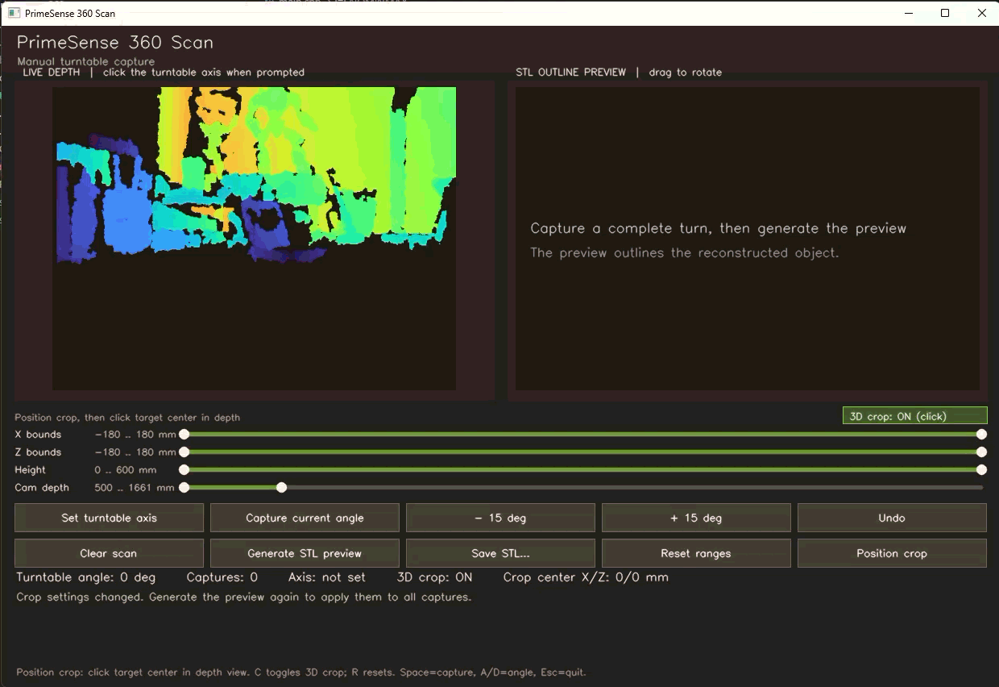

# PrimeSense 360 Degree Scanner to STL Converter

Windows C++ application for capturing PrimeSense/OpenNI depth frames from a
manually rotated turntable, previewing a reconstructed mesh, and saving it as
a binary STL in millimeters.



## Requirements

- Windows and Visual Studio C++ build tools
- OpenNI2, including its `Include`, `Lib`, and `Redist` directories
- OpenCV
- The `primesense-openni2-winusb` submodule for packaging the OpenNI2 runtime
  and, when needed, building its WinUSB sensor plugin

Initialize the required submodule:

```powershell
git submodule update --init components/primesense-openni2-winusb
```

Configure and build the scanner:

```powershell
cmake -S . -B build `
  -DOpenNI_DIR="C:\Program Files\OpenNI2" `
  -DOpenCV_DIR="C:\opencv\build"
cmake --build build --config Debug
```

The default build creates only the scanner executable. Its output is
`build\bin\Debug\3dscan_to_stl.exe`; the build also stages the OpenNI2 runtime
beside it.

If the camera uses the generic Windows WinUSB driver, build the matching
OpenNI2 sensor plugin into the scanner's app-local runtime:

```powershell
cmake --build build --config Debug --target build_winusb_openni
```

Mesh tests are optional and are not part of the default build:

```powershell
cmake -S . -B build -DBUILD_TESTING=ON
cmake --build build --config Debug --target scan_mesh_tests
ctest --test-dir build -C Debug --output-on-failure
```

## Scan workflow

1. Keep the camera fixed and center the object on a manually rotated turntable.
2. Select **Set turntable axis** and click the rotation center at the object's
   base in the live depth view.
3. Capture the starting angle, then rotate the turntable in 15-degree steps
   and capture each view. Capture a complete rotation with no gap over
   30 degrees; 24 views are recommended.
4. Select **Generate STL preview**, inspect the mesh, and select **Save STL**.

The **Camera depth** range filters points by distance from the camera. The
optional **3D crop** filters by turntable-relative X, Z, and Height bounds.
Toggle it using the on-screen control or `C`. With it off, the 3D bounds and
crop-center offset are ignored; camera-depth filtering stays active. Use
**Position crop** and click the target center in the live view to move the
crop box, then adjust the X/Z and Height bounds. Press `R` to reset crop and
camera-depth ranges.

`Space` captures, `A`/`D` change the displayed turntable angle, and `Esc`
quits. The angle controls do not rotate a physical turntable.

## Reconstruction limits

The mesh generator approximates an object's exterior as a radial profile
around the turntable axis. It works best for objects without deep undercuts.
The underside is not observed and the top and bottom are capped. The scan
volume is limited to about 360 mm in diameter and 600 mm in height. Inspect
the preview and validate the STL in a slicer before printing.
